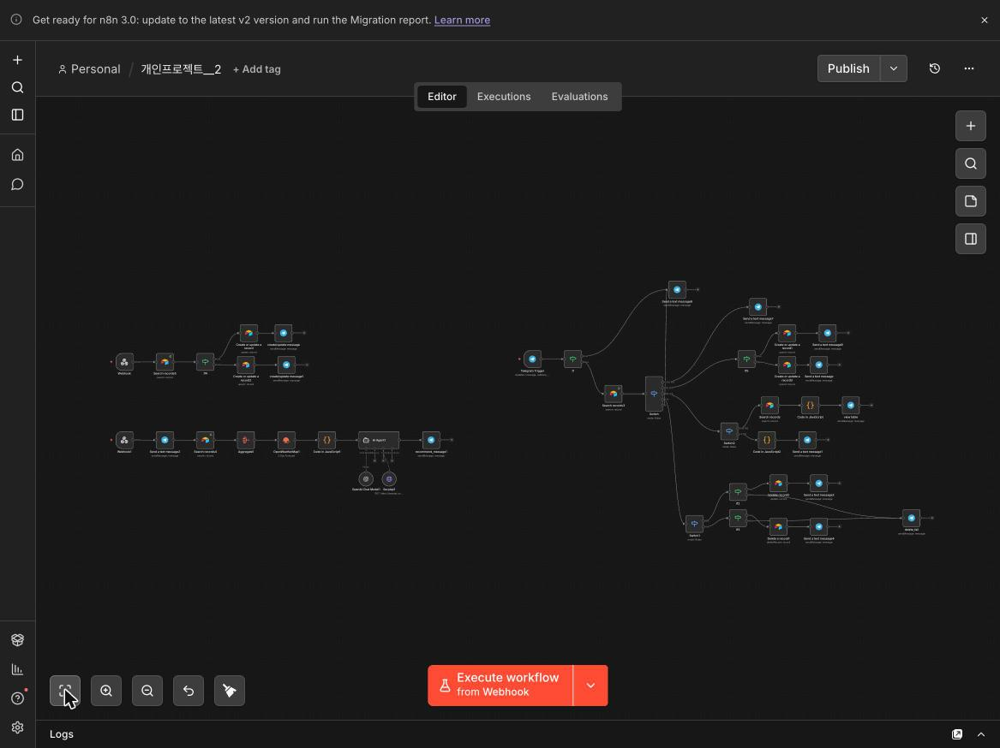

# 우리 어디서 봐? — 모임 장소 추천 텔레그램 봇

> 모두의 이동 시간이 비슷한 모임 장소를 추천하는 텔레그램 봇 (n8n · 규칙 + AI)

**문제** — 여럿이 만날 때 "어디서 볼까"는 항상 가장 멀리 사는 사람이 손해를 본다. 핫플레이스가 아니라 **모두의 이동 시간이 비슷한 곳**을 찾고 싶었다.

**흐름**

```
Telegram Trigger
  └─ Switch (명령 분기: 관심 활동 등록 / 출발지 등록 / 현황 조회 / 삭제 / 추천)
       ├─ 관심 활동  → Airtable 저장 → 등록 완료 메시지          ← 규칙
       ├─ 출발지     → Webhook(위치 입력 폼) → Airtable 저장       ← 규칙
       ├─ 현황 조회  → Airtable 조회 → 표 형태로 응답             ← 규칙
       ├─ 삭제       → Airtable 삭제 → 확인 메시지                ← 규칙
       └─ 추천       → 참여자 출발지·관심 활동 Aggregate
                       → AI Agent (SerpApi · OpenWeatherMap 도구) ← AI
                       → 추천 결과 메시지
```

**규칙 / AI 경계**
- 등록·조회·삭제 CRUD는 전부 Switch·If·Airtable 노드. LLM이 끼면 같은 입력에 다른 결과가 나올 수 있어서 뺐다.
- AI는 "출발지 N개 + 관심 활동 + 날씨"를 받아 장소를 고르는 **판단** 단계에만 쓴다.
- 에이전트 프롬프트에 **15분 편차 규칙**을 명시: 가장 오래 걸리는 사람과 가장 적게 걸리는 사람의 이동 시간 차이가 15분 안팎이 되는 역을 우선하고, 벗어나면 무게중심을 먼 사람 쪽으로 옮긴다. 평균이 아니라 **편차**를 줄이는 게 목표.

**배운 것** — 명령 분기를 Switch 하나로 모으니 새 기능을 붙일 때 분기만 추가하면 됐다. 42노드 중 AI 노드는 1개뿐이다.



## 사용

1. n8n → Workflows → Import from File → `workflows/01_meeting_place_telegram_bot.json`
2. 각 노드의 credential을 본인 계정으로 연결
3. placeholder 교체: `AIRTABLE_BASE_ID` `AIRTABLE_TABLE_ID` `YOUR_API_KEY`

credential과 외부 ID는 모두 placeholder로 바꿔 두었습니다.

## 환경

n8n (self-hosted, Docker) · Telegram · Airtable · OpenAI · SerpApi · OpenWeatherMap

---

다른 n8n 워크플로우와 규칙/AI를 나누는 기준은 [n8n-automation-workflows](https://github.com/sikumdev/n8n-automation-workflows)에 정리했습니다.
